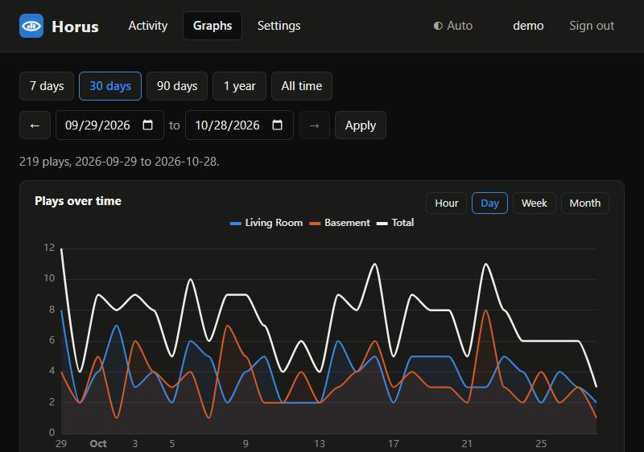
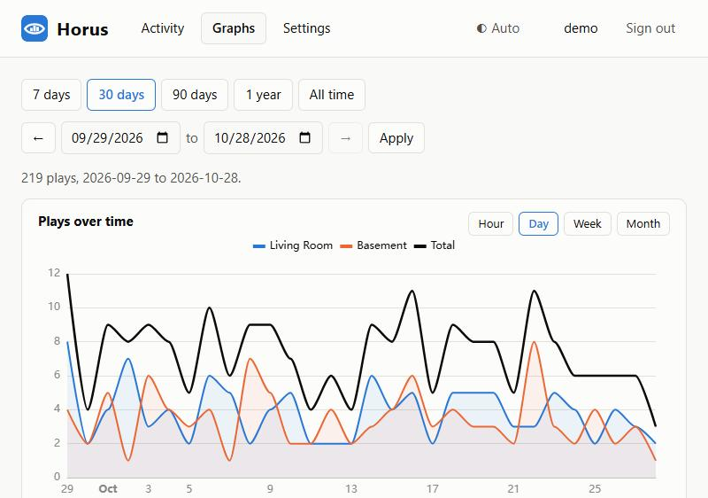
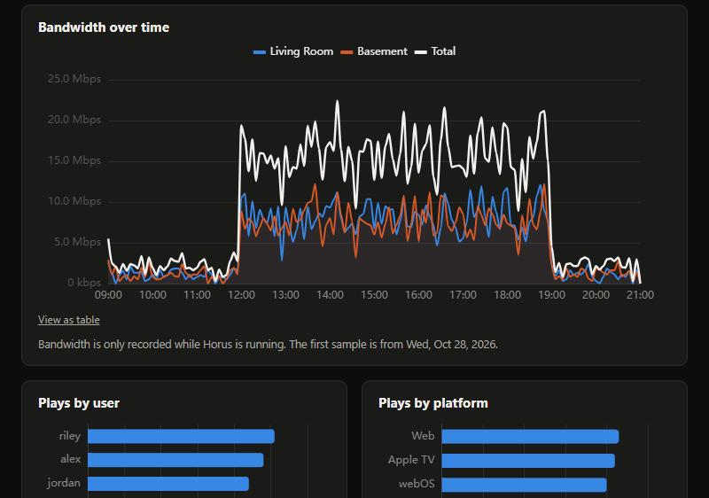
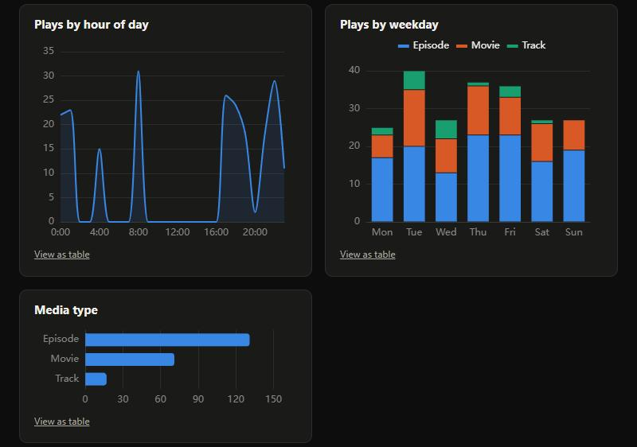

<p align="center"></p>

# Horus

A self-hosted dashboard for Plex and Emby. See what is playing on both servers right now, and how your libraries get watched over time.

> Status: working and in private development, not yet released. Works with Plex and Emby (not affiliated with either).

## Features
- Live activity from Plex and Emby in one view, with posters and full stream details
- Play history recorded locally (SQLite) from the moment you add a server
- Graphs: plays over time by hour, day, week or month; direct play vs transcode; bandwidth; plays by user, platform, hour and weekday; media types
- Accounts with admin and user roles (an email address works as a username), API keys, and a read-only data API for Grafana
- Optional control keys for testing and automation: off by default, always expiring, and never able to manage users or keys
- Backups and restore, application logs, and restart / shut down from the web UI
- Read-only: Horus never changes anything on your servers
- Light and dark themes

The Docker image (`ghcr.io/watchful-horus/horus-media`) and the release downloads are public and tested.

## Screenshots
Graphs in the dark theme, and in the light theme, then bandwidth and the hour and weekday breakdowns. The data shown is invented.

<p align="center"> </p>
<p align="center"> </p>

## Development
```bash
python -m venv .venv
.venv\Scripts\activate        # Windows (use source .venv/bin/activate on Linux/macOS)
pip install -e ".[dev]"
cp .env.example .env          # then fill in your own server URLs and keys
python -m horus_media                     # normal run: 127.0.0.1:8000 unless changed in Settings or HORUS_HOST / HORUS_PORT
uvicorn horus_media.main:app --reload     # development only (hot reload; the port is then set on the command line)
pytest
ruff check .
```
Build the web UI once (see below), then open http://127.0.0.1:8000/. The first visit asks you to create the first account.

### Web UI
Needs Node 20+. The built UI is served by the app from `src/horus_media/static/` (git-ignored):
```bash
cd web
npm install
npm run build      # then start Horus as above and open http://127.0.0.1:8000/
npm run dev        # or: hot-reload UI on :5173, proxying /api to uvicorn on :8000
```


## Configuration
- `HORUS_DB_PATH` (default `./data/horus.db`): SQLite file. An encryption key (`horus.key`) is created next to it on first run; server tokens are stored encrypted with it. Back up both files together and keep the key private.

- `HORUS_POLL_SECONDS` (default `15`; the Settings page overrides it once saved): how often Horus checks your servers and records plays. `0` turns recording off. Plays are only recorded while Horus is running. Set `TZ` (e.g. in Docker) so days and hours match your local time.
- `HORUS_PORT` / `HORUS_HOST` (default `8000` / `127.0.0.1`): where Horus listens. When set, they override the Settings page.
- `HORUS_AUTH_DISABLED` (`1` to turn the login off, only behind something that handles sign-in for you).
- `HORUS_UPDATE_URL`: release address for "Check for updates" (otherwise set in Settings).
- `HORUS_CONTAINER` (`1`): tells Horus it runs in a container, so Restart and Shut down are disabled (also detected automatically in Docker and Kubernetes).

## Settings page
Time zone, poll interval, history retention, automatic backups (every whole number of days at a time you choose, 03:00 by default) and the daily update check are set in **Settings > General** and saved in the database. The HTTP port and bind address are set outside the app (`HORUS_PORT`, `HORUS_HOST`, or Docker's port mapping).

- **Backups** are zips of the database plus `horus.key`, written to a `backups` folder next to the database. They contain your encrypted server tokens and the key to decrypt them, so keep them private. They are never served over HTTP; the page offers a separate download with the tokens removed. To restore, use the **Restore** button next to a backup in Settings: Horus checks the backup, saves the current state first (so a restore can be undone), then swaps it in. By hand: stop Horus, unzip over `horus.db` and `horus.key` in the data folder, start it again.
- **Update checks** only contact the *Release address* you set in Settings > General > System (or `HORUS_UPDATE_URL`), a GitHub-style "latest release" URL. On a new install the address of the Horus project is filled in and Horus looks for a newer release once a day (at 04:00 by default; change the time in Settings). It only reads the latest-release page, sends nothing about you or your servers, and never installs anything. Untick *Check for updates once a day* in Settings, or clear the address, to turn it off.

## Accounts and security
The first time you open Horus it asks you to choose a **username** and password. That first account is an admin. Until it exists, nothing else works. **Create it as soon as Horus starts:** until the first account exists, anyone who can open the page could create it, so do this before you share the address with anyone, and never put an unconfigured Horus on the internet. (By default Horus only listens on the computer it runs on until an admin exists. Docker and containers are different because they listen on the network from the start, and the Proxmox installer avoids the problem by creating the admin during the install.) After that every page and API call needs a sign-in (a browser session) or, for the data API only, an API key.

There are two roles. Admins add people in **Settings > Users** and choose each person's role:

| | Admin | User |
|---|---|---|
| Activity and Graphs | yes | yes |
| Change own password (Account) | yes | yes |
| Servers, settings, backups, logs, restart | yes | no |
| Add or remove people, API keys | yes | no |

Usernames are 3 to 64 letters, numbers, dots, dashes, underscores, `@` or `+`, so an email address works, and they are not case-sensitive. Usernames show up in the log (for example "login: name from address"), so treat a shared log as personal data. There is always at least one admin: the last one cannot be deleted or demoted, and you cannot delete or demote yourself. Anything added to Horus later is admin-only until it is deliberately opened to users.

- Passwords are stored as scrypt hashes; session tokens and API keys only as SHA-256 hashes. Repeated wrong passwords are slowed down, and sign-in errors do not say whether the username or the password was wrong.
- Changing or resetting a password signs that person out everywhere else.
- Users on a normal account can see everyone's Activity and Graphs, including other people's names and what they watched. Only give accounts to people you are happy to show that.
- Upgrading from the earlier single-admin version keeps your password: that account becomes the admin, with the username `admin`.
- `HORUS_AUTH_DISABLED=1` turns the login off, for people who put their own sign-in in front of Horus (such as a reverse proxy with SSO). There are no accounts then, and anyone who can reach Horus can use it.
- Restoring a backup also restores the accounts and API keys that were in it.

## Port, network access, restart and shut down
In **Settings > General > Network** you can change the HTTP port and choose whether other computers may connect. By default Horus listens on this computer only (`127.0.0.1`, port 8000). Changes apply after a restart, and the page has a **Restart now** button for that.

- It works however you started Horus. A restart always relaunches Horus as `python -m horus_media`, which uses the port saved in Settings, so if you started it with `uvicorn ... --port` the first restart after changing the port switches it over. Starting it with `python -m horus_media` in the first place is simplest.
- `HORUS_PORT` and `HORUS_HOST` override the settings (the page then shows them as locked).
- Opening Horus to other computers is only possible once an admin account exists.
- **Settings > General > System** also has **Restart** and **Shut down** (admins only). Shut down stops Horus until you start it again yourself.
- In Docker or Kubernetes the container owns the port, restart and stop, so those controls are switched off: change the port mapping and restart the container instead.

## Data API for Grafana and other tools
Create an API key in **Settings > API**, then read your data over HTTP. Send the key as `Authorization: Bearer <key>` or `X-API-Key: <key>`. A key can only use the read-only `/api/v1` endpoints; it cannot change anything, add servers or see server tokens or addresses. Every endpoint returns a plain JSON array (or CSV with `format=csv`).

| Endpoint | What it returns |
|---|---|
| `GET /api/v1/plays?from&to&interval=hour\|day\|week\|month&by=none\|server\|user\|platform\|play_method\|media_type` | Plays per time bucket |
| `GET /api/v1/bandwidth?from&to&interval=auto\|1m\|5m\|15m\|1h\|1d` | Average and peak kbps per server, plus a combined `Total` |
| `GET /api/v1/history?from&to&server&user&limit&offset` | Individual plays, newest first |
| `GET /api/v1/activity` | What is playing now, one row per stream |
| `GET /api/v1/servers` | Server names and types |

`from` and `to` take dates, ISO date-times, or epoch milliseconds (Grafana's `${__from}` and `${__to}`). Days and hours follow the time zone in Settings.

In Grafana, install the **Infinity** data source, add it with *Bearer Token* authentication and your key, and point a JSON panel at one of the addresses above, for example `http://horus:8000/api/v1/plays?from=${__from}&to=${__to}&interval=day&by=server`. Set `time` as a Timestamp column and use the Time series format to get one line per server. Grafana makes the requests from wherever it runs, so Horus must be reachable from there (see *Port and network access*).

## Installing without a development setup
**Docker** (needs Docker with Compose): copy `compose.example.yaml` to `compose.yaml`, set your time zone, and run `docker compose up -d`. Open port 8000 and create the first account straight away: the container listens on the network from the start, so until the account exists anyone who can reach the page could create it. Data (database, key, backups, logs) lives in the `horus-data` volume. Restart and shut down are done with Docker, not the web UI.

**Proxmox VE container:** `scripts/proxmox/horus-lxc.sh` creates a small Debian 13 container, installs Horus as a service and prints the address. It is a wizard (default or advanced settings, with menus for storage and network) that also asks for the administrator username and password and creates that account before Horus starts, so the first-run setup code is never needed; leave the password blank and it generates one and shows it at the end. The install shows one line per step with a spinner and keeps the full output in a log file (`HORUS_VERBOSE=1` prints everything instead). Run it on the Proxmox host as root, pointing `HORUS_PACKAGE` at a Horus wheel (build one with `cd web && npm run build && cd .. && pip wheel . --no-deps -w dist`), for example `HORUS_PACKAGE=/root/horus_media-0.1.3-py3-none-any.whl bash horus-lxc.sh`. CPU, RAM, disk, storage, network and port can be set with environment variables (listed at the top of the script). Update later with `bash horus-lxc.sh update <container id>`; the data is kept. Restart and shut down work from the web UI.

## Moving to a new install
On a fresh install the first screen has **Already use Horus? Restore from a backup instead**. Choose a backup zip (Settings > Backups > Download on the old install) and your accounts, servers and history come back. In an existing install use **Restore from a file...** under Settings > Backups. Backups can be deleted from the same list.

## Importing past history
Horus records plays from the moment it starts watching a server. To bring in older plays, open **Settings > Servers** and press **Import history** on a server.

**Plex.** Nothing to set up: Plex hands over everything in its own history.

**Emby.** Emby does not keep a play history of its own, so Horus reads it from the **Playback Reporting** plugin:
1. In Emby open **Dashboard > Plugins > Catalogue**, find **Playback Reporting** and install it.
2. Restart Emby when it asks.
3. Make sure the API key you gave Horus is an administrator's (create one under **Dashboard > API Keys**).
4. Press **Import history** in Horus.

The plugin only has plays from the day it was installed, so a new install has little or nothing to import. If it was installed long ago, you get all of that history.

If the import says the plugin was not found, Emby answered "not found" (usually the plugin is not installed, or Emby was not restarted after installing it) or refused the key (it is not an administrator's). Turn the log level to DEBUG under **Settings > Logs** and try again: the log shows the status Emby answered (404 means the plugin is missing, 401 or 403 means the key is not an administrator's).

**Import once, right after you add the server.** Importing only reads from the server and changes nothing on it. Running it again adds nothing new: each play has a stable key, so one already imported is skipped. Plays Horus recorded live are skipped too, matched by user, title and start time (within two minutes). Plex names a play the same way in both places, so those match. Emby's plugin may name a play differently from how Horus saw it live, so on Emby the longer Horus has been recording before you import, the likelier a few plays count twice. Imported plays have no bandwidth figure, and Plex does not say how a past play was streamed, so those show as "Unknown" in the direct play vs transcode charts.

## Privacy between users
Under **Settings > General**, *Normal users see only their own activity* limits what normal users (and their API keys) can see to plays by one Plex/Emby name. Link that name to each account under **Settings > Users**. Without a linked name they see nothing. Admins always see everything. Server-wide bandwidth is hidden from limited users, because it would reveal what others are watching. Any signed-in person can create their own API keys under **Account**; a key acts as its owner.

## Prometheus metrics
`GET /metrics` returns Prometheus text: whether each server is up, streams by play method, combined stream bandwidth, and plays recorded. Only server names appear in labels. It needs an admin's API key (Settings > API), sent with Prometheus's `authorization` setting:

```yaml
scrape_configs:
  - job_name: horus
    authorization: { credentials: hk_your_key }
    static_configs: [{ targets: ["horus:8000"] }]
```

## Notifications and Seerr
**Settings > Integrations** can post a message to a Discord channel webhook, an ntfy topic, or any web address (JSON) when someone starts or finishes playing, or a server becomes unreachable or comes back. Channel addresses are secrets: they are stored encrypted and never shown again. Three optional alerts (**Settings > General > Alerts and reports**, all off by default) use the same channels: too many transcodes at once, a server's bandwidth over a limit, and someone Horus has never seen starting to play. Each is sent once when the limit is crossed. The same section can send a weekly or monthly summary report; **Integrations > Report** shows one on screen, downloads it as CSV, or sends it now. Tick the matching event on a channel to receive them. Connecting Overseerr or Jellyseerr adds a **Requests** tab listing recent media requests (Horus only reads from Seerr).

## Start at login (Windows)
```
python -m horus_media startup install
python -m horus_media startup status
python -m horus_media startup remove
```
This adds or removes one entry under your own account's Run key (no administrator rights) that starts Horus without a console window, using the data folder you installed it from.

## Theme
The header button cycles Auto (follow the system), Light and Dark. The choice is remembered in that browser.

## Logs
Horus writes an application log to `logs/horus.log` next to the database (rotating, about 10 MB at most) and to the console. Read it in **Settings > Logs** (filter by level, search, download) or open the file. It records starts and stops, servers added or removed, connection tests, plays starting and ending, servers going unreachable and coming back, sign-ins, user and settings changes, backups and restores. How much is recorded is set on the same page under *Recording detail* (default *Normal*; use *Everything* when troubleshooting).

Tokens, API keys, passwords and credentials inside URLs are scrubbed before anything is written, and the code avoids logging them in the first place. Plays include usernames and titles, so treat a shared log like any other personal data.

## Adding servers
- **Plex:** use *Sign in with Plex* in Settings > Servers: Horus opens plex.tv in a new tab, you approve, then pick a server. Horus contacts plex.tv only for this step. Or paste an `X-Plex-Token` manually.
- **Emby:** create an API key in the Emby dashboard (Advanced > API Keys) and paste it in.

## Contributing and security
Help is welcome: see [CONTRIBUTING.md](CONTRIBUTING.md) for the ground rules and how to set up. To report a security problem privately, see [SECURITY.md](SECURITY.md).

## Licence
Horus is released under the [MIT licence](LICENSE). Plex and Emby are trademarks of their owners; Horus is not affiliated with or endorsed by either.

## API
- `POST /api/servers` add `{type: plex|emby, name, url, token}`; `GET /api/servers`; `DELETE /api/servers/{id}`
- `POST /api/plex/link`, `GET /api/plex/link/{pin}`, `POST /api/plex/link/{pin}/add` the Sign in with Plex flow (the account token never leaves the server)
- `POST /api/servers/{id}/test` test a saved server; `POST /api/servers/test` test `{type, url, token}` without saving
- `GET /api/activity` live sessions from all servers, merged, plus per-server status
- `GET /api/stats?start=YYYY-MM-DD&end=YYYY-MM-DD` aggregated history for the graphs
- Tokens are never returned by the API.

### Control keys (for testing and automation)
An ordinary API key can only read the data endpoints under `/api/v1`. A **control key** can also run Horus: make and restore backups, change settings, add servers, import history, read the log, restart and shut down. It acts as the admin who made it, with these limits:
- **Off by default.** An admin switches control keys on under **Settings > API > Control keys**. Switching them off stops every control key at once.
- **Always expires.** Choose 24 hours, 7, 30 or 90 days when you make one.
- **Never users, keys or sign-in.** A control key cannot create or delete people, create or revoke keys, change passwords or sign in, and cannot switch control keys on or off.
- **Logged.** Every use is written to the log with the key's name, never the key itself.
- A control key stops working if its owner is no longer an admin.

Send it as `Authorization: Bearer hk_...` (or `X-API-Key`). `scripts/horusctl.py` is a small command-line helper that reads the address and key from a git-ignored `.env` file (`HORUS_TEST_URL`, `HORUS_TEST_CONTROL_KEY`) and never prints the key, for example `python scripts/horusctl.py GET /api/settings`. Only give a control key to something you trust, and use it on a network you trust or over HTTPS: a key sent over plain http can be read by anyone on the same network.
